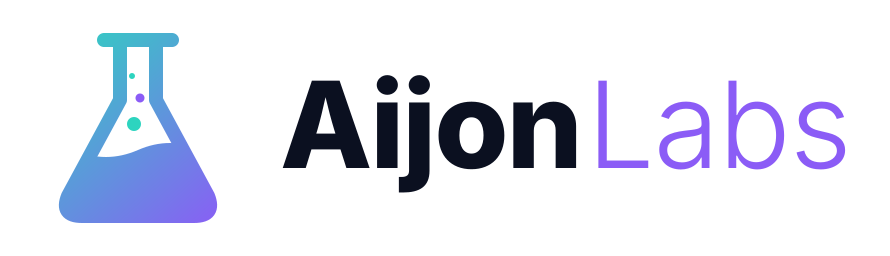

<p align="center">
  <picture>
    <source media="(prefers-color-scheme: dark)" srcset="assets/brand/aijonlabs-logo-dark.svg">
    
  </picture>
</p>

<p align="center"><em>Plugins para Claude Code y userscripts para el navegador, creados y mantenidos por Xavi Aijon.</em></p>

*[Read in English](README.md)*

[](https://github.com/xavieraijon/aijon-labs/actions/workflows/ci.yml)
[](LICENSE)

Un marketplace de plugins para [Claude Code](https://code.claude.com), y algunos userscripts para el navegador.
De momento tiene un plugin, `coolify-ops`, para autoalojar tus despliegues, y un userscript, `tradesea-crt`, para
quien opera en Tradesea. Vendrán más plugins (skills, hooks y mods de la interfaz), y cada uno se instala por
separado.

## Instalar

En Claude Code, añade el marketplace una vez y después instala los plugins que quieras, por ejemplo:
```
/plugin marketplace add xavieraijon/aijon-labs
/plugin install coolify-ops@aijon-labs
```
Después ejecuta `/reload-plugins` (o reinicia Claude Code): al escribir `/coolify-ops:` aparecen sus skills, que
también se activan cuando lo pides con tus palabras. Para actualizar: `/plugin marketplace update aijon-labs`
refresca el catálogo y `/plugin update coolify-ops@aijon-labs` instala la versión nueva (reinicia para aplicarla).

## Plugins

| Plugin | Qué hace | Necesitas | Para empezar |
|---|---|---|---|
| [`coolify-ops`](plugins/coolify-ops/README.es.md) | Gestiona tu propio servidor [Coolify](https://coolify.io) (un Heroku/Vercel autoalojado) desde Claude Code: móntalo en un VPS o en casa, y despliega en él tus proyectos —escribe el Dockerfile si no tienen (FastAPI, Django, Laravel, Next.js, Nuxt, SPAs y más)— con dominio HTTPS, PostgreSQL opcional con copias de seguridad y despliegue automático en cada push, todo por la API de Coolify | Un VPS o un servidor en casa, un dominio, GitHub (`gh` con sesión iniciada), y Docker y Python 3.10+ en tu ordenador ([detalles](plugins/coolify-ops/README.es.md#requisitos)) | [README](plugins/coolify-ops/README.es.md) · tutorial [Coolify desde cero](docs/es/coolify-desde-cero.md) · [app de ejemplo](examples/hello-fastapi/) (con el servidor ya montado) |

## Userscripts

Pequeñas herramientas que funcionan en tu navegador con un gestor de userscripts
([Tampermonkey](https://www.tampermonkey.net/) o [Violentmonkey](https://violentmonkey.github.io/)). No necesitan
Claude Code: pulsas *Instalar*, confirmas y se actualizan solas desde este repositorio.

| Userscript | Qué hace | Funciona en | Para empezar |
|---|---|---|---|
| [`tradesea-crt`](userscripts/tradesea-crt/README.es.md) | Encuentra los setups de Candle Range Theory (CRT) en las temporalidades que elijas, de 15 minutos a mensual, y dibuja su rango como Horizontal Rays en tus gráficos, en tiempo real: los setups completados o invalidados desaparecen solos | [Tradesea](https://app.tradesea.ai) en Chrome, Edge o Firefox | [Instalar](https://raw.githubusercontent.com/xavieraijon/aijon-labs/main/userscripts/tradesea-crt/tradesea-crt.user.js) · [README](userscripts/tradesea-crt/README.es.md) |

Versiones y cambios: [CHANGELOG](CHANGELOG.md) (en inglés) y
[releases](https://github.com/xavieraijon/aijon-labs/releases) (etiquetas `<plugin>-v<versión>`).

## Cómo se comportan los plugins

Todos los plugins de aquí siguen las mismas reglas:
- Todo lo irreversible o que sale hacia fuera (borrar, restaurar, publicar) pregunta antes.
- El `git push` y todo lo que publica lo haces tú: los plugins preparan el commit y te dan la orden.
- Los tokens y contraseñas nunca pasan por el chat y se enmascaran en toda la salida.
- En este repositorio no hay nada personal; tu configuración se queda en tu propia carpeta.
- Los scripts solo usan la biblioteca estándar de Python y se prueban sin red.

El README de cada plugin detalla sus propias garantías. Más detalle, y cómo avisar de una vulnerabilidad, en
[seguridad](docs/es/seguridad.md).

## Estructura

```
.claude-plugin/marketplace.json   catálogo del marketplace
plugins/<plugin>/
  .claude-plugin/plugin.json      manifiesto del plugin (nombre, versión, autor)
  skills/<skill>/SKILL.md         instrucciones de la skill (+ scripts/, templates/, reference/)
  tests/                          tests de pytest (sin red)
  README.md
userscripts/<nombre>/
  <nombre>.user.js                el userscript (un solo archivo, sin dependencias)
  README.md, README.es.md
examples/                         apps de ejemplo para probar los plugins
docs/en/, docs/es/                tutoriales y guías para contribuir
```

## Contribuir

Los informes de fallos en servidores reales son muy bienvenidos. Ver [contribuir](docs/es/contribuir.md), las
[convenciones](docs/es/convenciones.md) y las guías para crear [skills](docs/es/crear-skill.md),
[hooks](docs/es/crear-hook.md) y [mods](docs/es/crear-mod.md).

```bash
python3 -m venv .venv && .venv/bin/pip install pytest ruff
.venv/bin/ruff check . && .venv/bin/python -m pytest -q plugins && claude plugin validate . --strict
```

## Licencia

[MIT](LICENSE). Sin relación oficial con Coolify, Anthropic, Tradesea ni TradingView.
