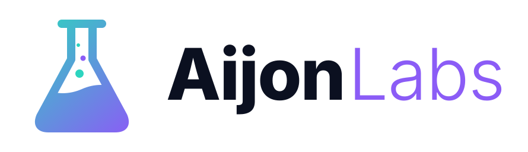

<p align="center">
  <picture>
    <source media="(prefers-color-scheme: dark)" srcset="assets/brand/aijonlabs-logo-dark.svg">
    
  </picture>
</p>

<p align="center"><em>Plugins para Claude Code, creados y mantenidos por Xavi Aijon.</em></p>

*[Read in English](README.md)*

[](https://github.com/xavieraijon/aijon-labs/actions/workflows/ci.yml)
[](LICENSE)

Un marketplace de plugins para [Claude Code](https://code.claude.com): skills, hooks y mods para autoalojar tus
proyectos y automatizar el día a día. Cada plugin se instala por separado.

| Plugin | Qué hace |
|---|---|
| [`coolify-ops`](plugins/coolify-ops/) | Gestiona tu propio servidor [Coolify](https://coolify.io) (un Heroku/Vercel autoalojado) desde Claude Code: móntalo en un VPS o en casa, y despliega tus proyectos con Dockerfile, dominio HTTPS, PostgreSQL opcional y despliegue automático en cada push, todo por la API de Coolify |

## Empezar

En Claude Code:
```
/plugin marketplace add xavieraijon/aijon-labs
/plugin install coolify-ops@aijon-labs
```
En tu ordenador necesitas Python 3.10+, `git`, la CLI de GitHub `gh` (con sesión iniciada) y Docker para la
prueba local ([requisitos](plugins/coolify-ops/README.es.md#requisitos)). Para desplegar hace falta antes un
servidor con Coolify y un token de su API: si no lo tienes, empieza por la primera línea de abajo o por
[¿Nuevo en Coolify?](#nuevo-en-coolify).
Y después, pídelo con tus palabras:
```
> monta Coolify en mi VPS usuario@203.0.113.10 con el dominio ejemplo.org
> monta Coolify en mi servidor de casa usuario@192.168.1.20 con el dominio tunombre.duckdns.org
> despliega ~/Projects/mi-tienda
> /coolify-ops:deploy-app status
```
Montar el servidor es guiado, no automático: la skill comprueba cada paso, y tú ejecutas las órdenes con `sudo` en
tu propia terminal y haces los pasos del router y del navegador.

Así es un despliegue: Claude analiza el proyecto, le escribe un Dockerfile si no tiene, lo construye y lo prueba en
tu máquina, y te enseña **un solo resumen**:
```
App:          mi-tienda  (fastapi, plantilla python-fastapi)
Repo:         tu/mi-tienda · rama main · 1 commit por subir
Dominio:      https://mi-tienda.ejemplo.org   (libre ✔)
Base datos:   PostgreSQL 17 (nueva, privada)
Recursos:     máx. 1 CPU / 512m
Autodeploy:   sí (cada push publica)
Prueba local: OK (9 s de build, rutas / 200, /health 200)
```
Tras tu «sí» te da la orden de `git push`; cuando la ejecutas, lo crea todo en Coolify, despliega y comprueba el
HTTPS desde fuera.

## ¿Nuevo en Coolify?

Sigue **[Coolify desde cero](docs/es/coolify-desde-cero.md)** —hardware, VPS o servidor en casa, DNS, seguridad,
instalación, GitHub y la API— o deja que la skill `provision-server` te acompañe y compruebe cada paso. Después
prueba con la [app de ejemplo](examples/hello-fastapi/).

## Seguro por diseño

- Una sola confirmación por despliegue; borrar, rollback y force push preguntan siempre.
- El `git push` lo haces siempre tú: las skills preparan el commit y te dan el comando.
- Los tokens y contraseñas nunca pasan por el chat y se enmascaran en toda la salida.
- Sin `sudo` ni contraseñas en los servidores, y sin aceptar claves ssh desconocidas.
- Las bases de datos son privadas y nunca se abren puertos por ti.

Más en [seguridad](docs/es/seguridad.md).

## Estructura

```
.claude-plugin/marketplace.json   catálogo del marketplace
plugins/<plugin>/
  .claude-plugin/plugin.json      manifiesto del plugin (nombre, versión, autor)
  skills/<skill>/SKILL.md         instrucciones de la skill (+ scripts/, templates/, reference/)
  tests/                          tests de pytest (sin red)
  README.md
examples/                         apps de ejemplo para probar los plugins
docs/en/, docs/es/                tutoriales y guías para contribuir
```

## Contribuir

Los informes de fallos en servidores reales son muy bienvenidos. Ver [contribuir](docs/es/contribuir.md), las
[convenciones](docs/es/convenciones.md) y las guías para crear [skills](docs/es/crear-skill.md),
[hooks](docs/es/crear-hook.md) y [mods](docs/es/crear-mod.md).

```bash
python3 -m venv .venv && .venv/bin/pip install pytest ruff
.venv/bin/ruff check . && .venv/bin/python -m pytest -q plugins && claude plugin validate . --strict
```

## Licencia

[MIT](LICENSE). Sin relación oficial con Coolify ni con Anthropic.
