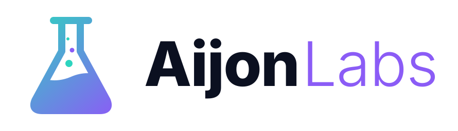

<p align="center">
  <picture>
    <source media="(prefers-color-scheme: dark)" srcset="assets/brand/aijonlabs-logo-dark.svg">
    
  </picture>
</p>

<p align="center"><em>Claude Code plugins, built and maintained by Xavi Aijon.</em></p>

*[Leer en castellano](README.es.md)*

[](https://github.com/xavieraijon/aijon-labs/actions/workflows/ci.yml)
[](LICENSE)

A [Claude Code](https://code.claude.com) plugin marketplace: skills, hooks and mods for self-hosting and
everyday automation. Each plugin installs on its own.

## Install

In Claude Code, add the marketplace once, then install the plugins you want:
```
/plugin marketplace add xavieraijon/aijon-labs
/plugin install <plugin>@aijon-labs
```
Each plugin installs and updates on its own (`/plugin marketplace update aijon-labs` fetches new versions); its
skills appear as `/<plugin>:<skill>` and also trigger when you ask in your own words.

## Plugins

| Plugin | What it does | Get started |
|---|---|---|
| [`coolify-ops`](plugins/coolify-ops/) | Run your own [Coolify](https://coolify.io) server (a self-hosted Heroku/Vercel) from Claude Code: set it up on a VPS or a home server, then deploy your projects with a Dockerfile, HTTPS domain, optional PostgreSQL with backups and auto-deploy on every push — all through the Coolify API | [README](plugins/coolify-ops/) · tutorial [Coolify from scratch](docs/en/coolify-from-scratch.md) · [example app](examples/hello-fastapi/) |

Versions and changes: [CHANGELOG](CHANGELOG.md) and [releases](https://github.com/xavieraijon/aijon-labs/releases)
(tagged `<plugin>-v<version>`).

## How the plugins behave

Every plugin here follows the same rules:
- Anything irreversible or outward-facing (deleting, restoring, publishing) asks first.
- `git push` and anything that publishes are yours: the plugins prepare the commit and give you the command.
- Tokens and passwords never go through the chat and are masked in all output.
- Nothing personal lives in this repository; your settings stay in your own config folder.
- Scripts use only the Python standard library and are tested offline.

Each plugin's README lists its own guarantees. Details, and how to report a vulnerability, in
[SECURITY.md](SECURITY.md).

## Repository layout

```
.claude-plugin/marketplace.json   the marketplace catalogue
plugins/<plugin>/
  .claude-plugin/plugin.json      plugin manifest (name, version, author)
  skills/<skill>/SKILL.md         skill instructions (+ scripts/, templates/, reference/)
  tests/                          pytest tests (offline)
  README.md
examples/                         sample apps to try the plugins
docs/en/, docs/es/                tutorials and contributor guides
```

## Contributing

Bug reports from real servers are very welcome. See [CONTRIBUTING.md](CONTRIBUTING.md), the
[conventions](docs/en/conventions.md) and the guides for [skills](docs/en/creating-a-skill.md),
[hooks](docs/en/creating-a-hook.md) and [mods](docs/en/creating-a-mod.md).

```bash
python3 -m venv .venv && .venv/bin/pip install pytest ruff
.venv/bin/ruff check . && .venv/bin/python -m pytest -q plugins && claude plugin validate . --strict
```

## License

[MIT](LICENSE). Not affiliated with Coolify or Anthropic.
